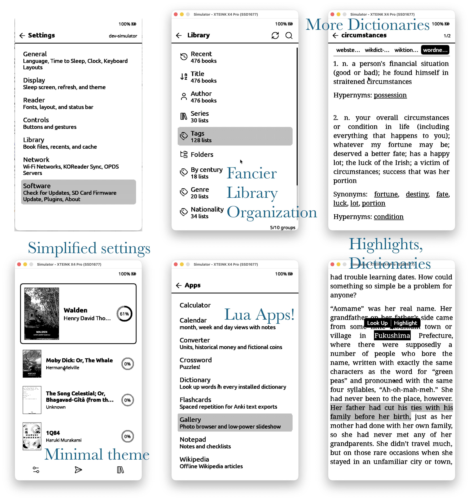

# nexlibrOS

> **This is a personal fork of the fantastic [CrossPoint Reader](https://github.com/crosspoint-reader/crosspoint-reader)** with a handful of what I'd call quality-of-life improvements and a reskin of the homescreen, optimized for the Xteink X4 Pro device with touch screen.

Specifically I've added

* A lua-based app system, which I think probably covers the basic utilities I want
  * Calculator
  * Calendar
  * Converter
    * Convert between a wide variety of units and currencies, including historical exchange rates adjusting for inflation
  * Crosswords
    * Can probably render arbitrary .puz files, works on every one I've tried so far
  * Dictionary
  * Flashcards
    * Anki-very-light: load simple text-only Anki decks and go through them with basic spaced repetition
  * Gallery
  * Notepad
    * typing is a pretty poor experience, but I guess I might as well
  * Wikipedia
    * Can fit the top 50000 articles dumped from https://dumps.wikimedia.org/kiwix/zim/wikipedia/ into ~500kb
  * Is this all a bit silly? A phone app would probably do better in 99% of circumstances, but maybe a bit helpful with the long battery life
* An understanding and preference for optimized epubs created with the Calibre plugin and served via OPDS (set up and accessible via e.g. https://publiclibrary.of.nhawk.in)
* A simplified, organized settings screen
* Parsing of additional metadata, including author, title sort fields and tags
* Customizable library organization
* Long tap a word in reader mode to define or add highlights
* Show bookmarks in the corner of the page
* Tab select between different dictionaries
* Simplified 'Nolan' theme, highlighting recent books with small icon menu for settings, file management, and opening the library

This satisfies my immediate wants out of CrossPoint, although I may still explore. Ideally I keep adding features as I think of them, and try to merge upstream where it seems available
